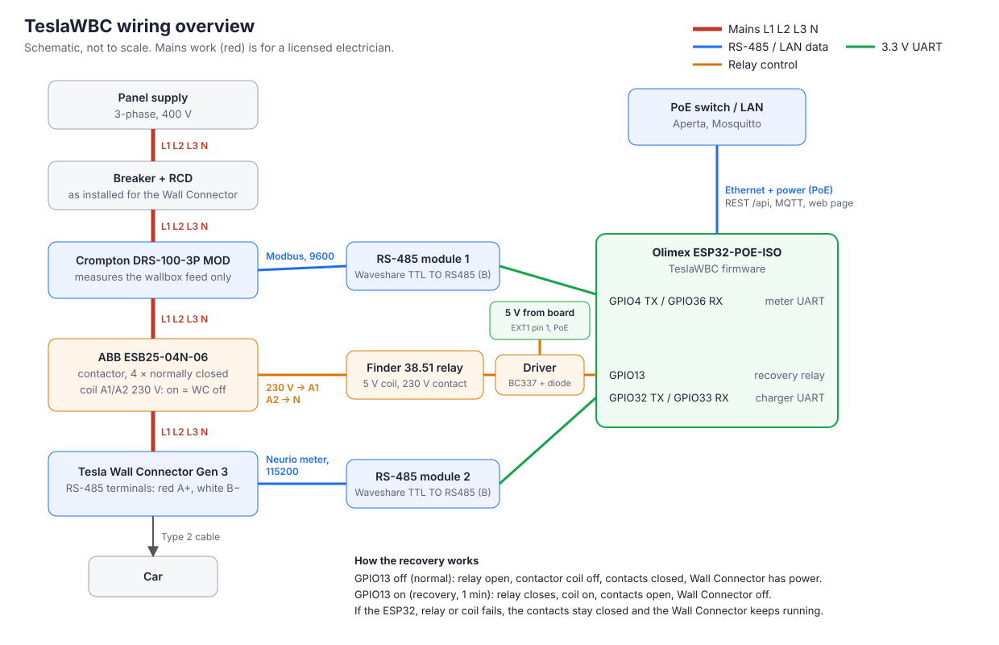

# TeslaWBC

Local current control for a **Tesla Wall Connector Gen 3**, without the Tesla cloud.

An ESP32 reads a dedicated energy meter on the wallbox feed and poses as the Neurio meter that the Wall Connector polls over RS-485. By choosing which current it reports, it makes the charger hold a target current between 6 and 16 A (three-phase), or pause. The ESP32 has no logic of its own. The building platform (Aperta) sets the mode and the target over MQTT or REST, and the ESP32 falls back to a configured target if Aperta goes silent.

## Hardware

| Part | Role |
|---|---|
| Olimex ESP32-POE-ISO-16MB-IND | Controller, powered and networked over PoE |
| 2 × Waveshare TTL TO RS485 (B) | One per bus, automatic direction control |
| Crompton DRS-100-3P MOD | Measures only the wallbox feed (Modbus RTU) |

### Pins

| Bus | Module pin | ESP32 pin | Olimex header |
|---|---|---|---|
| Meter (bus 1) | RXD | GPIO4 (TX) | UEXT pin 3 |
| Meter (bus 1) | TXD | GPIO36 (RX) | UEXT pin 4 |
| Charger (bus 2) | RXD | GPIO32 (TX) | GPIO header |
| Charger (bus 2) | TXD | GPIO33 (RX) | GPIO header |
| Recovery relay (optional) | IN | GPIO13 | UEXT pin 6 / GPIO header |
| Both | VCC / GND | 3.3 V / GND | UEXT pins 1 and 2 |

The ESP32's TX goes to the module's RXD input. If a bus stays silent, swapping TX and RX at the module is the first thing to try.

Ethernet uses GPIO12, 17, 18, 19, 21, 22, 23, 25, 26 and 27. GPIO34 is the user button, GPIO35 and GPIO39 are battery and power sensing. The pins are set as substitutions at the top of `teslawbc.yaml`.

On the charger bus, connect A+ and B- to the Wall Connector's RS-485 terminals (red = A+, white = B-). The Wall Connector is terminated internally, so fit the 120 Ω terminator on the module at the cabinet end.

## How control works

The Wall Connector lowers the car's current whenever the meter reports more than its **Max Conductor Limit L**. TeslaWBC reports

```
R = max(W1, W2, W3) + (L - T)
```

on CT1 to CT3, where W is the wallbox's own phase current from the DRS-100 and T is the target. If the car draws more than T, R exceeds L and the charger turns it down. If it draws less, the charger lets it climb. The car settles at T after 5 to 20 s.

R follows the car's current 1:1 and is never below what the wallbox draws. Both matter: the charger stops trusting a meter that breaks these rules, sometimes for hours.

| Mode | Reported R | Charger behaviour |
|---|---|---|
| Bypass | max(W) | Charges as if TeslaWBC were not there |
| Manual | max(W) + (L - T) | Holds T, clamped to Min Current (default 6 A) up to Max Output Current. Below Min Current it pauses |
| Pause | max(L, max(W)) + 2 A | Opens the contactor, resumes when the mode changes |

### Smooth and live signal

Field reports show the charger also distrusts a meter whose value stays flat for minutes, or jumps in steps its own current does not explain. So TeslaWBC shapes R before serving it:

- **Ramp:** the part TeslaWBC adds on top of the car's current, R − max(W), moves to its new value at *Ramp Rate* (default 0.25 A/s). A target change from 16 A to 6 A therefore takes about 40 s, and so do a pause and a return to Bypass. Changes in the car's own current still pass through at once.
- **Dither:** a few hundredths of an amp of noise (0 to +0.1 A) keep R from ever being flat, also in a pause and on a meter fault. It only adds, so R never drops below what the wallbox draws.
- A **meter fault** is served at once, without a ramp: with no measurement there is nothing to follow, and stopping the car is the safe side.

### Fail-safes

- **Meter fault** (no valid reading for 3 s): report L + 2 A, so charging pauses. This applies in every mode, including Bypass.
- **Aperta silent** (no command or heartbeat for longer than *Fallback Timeout*, default 5 min): Manual and Pause switch to *Fallback Target* (default 6 A; 0 means pause). Bypass stays Bypass.
- **ESP32 off or crashed**: the charger falls back to Tesla's built-in 6 A cap.
- **Bypass mode** is the kill switch, without rewiring.
- **Control Lost alarm**: if the charger ever judges the meter implausible, it ignores it, sometimes for hours, and charges at its own maximum; Pause stops working too. TeslaWBC raises *Control Lost* when the car draws more than 1.5 A above the target, or more than 1 A during a pause, for 3 minutes. It clears as soon as the charger follows again. Aperta should alert on it. Recovery that worked for others: switch the Wall Connector off and on, then send it an honest signal (Bypass) for about 2 hours. TeslaWBC can do this by itself (see below).

### Automatic recovery

With a contactor in the Wall Connector's feed, TeslaWBC restores trust by itself:

1. *Control Lost* is raised (and *Auto Recovery* is on).
2. The relay output energizes the contactor coil for 1 minute: the Wall Connector is off. TeslaWBC switches to Bypass.
3. Power returns; TeslaWBC stays in Bypass for *Recovery Bypass Time* (default 2 h).
4. Back to the mode Aperta set.

It tries automatically at most once per 24 hours. If trust is lost again within that time, the alarm stays on for a person to look at. *Recover Wall Connector* (button, `POST /api/recovery`, MQTT) starts a recovery by hand, *Cancel Recovery* ends it. *Recovery Active* and *WC Power Cut* show what is happening.



**Hardware** (electrician work, in the panel):
- **Contactor:** 4-pole, all contacts **normally closed**, rated at least for the Wall Connector's breaker, switching L1, L2, L3 and N. Example: ABB ESB25-04N-06 (4 NC, 25 A AC-1, 230 V coil); the 40 A version for a larger breaker. Normally closed means the Wall Connector keeps its power when the coil, the relay or the ESP32 fails.
- **Interface relay** for the coil, driven by GPIO13 (`recovery_relay_pin`): e.g. Finder 38.51.7.005.0050 (5 V coil) through an NPN transistor (BC337, 1 kΩ base resistor, flyback diode), or a ready-made 3.3 V relay module. Its 5 V comes from the board's +5V pin (EXT1 pin 1), which the PoE supply feeds; the ESP32-POE-ISO can source 200 to 400 mA there depending on revision, and the relay needs about 40 mA. The board has a 2.2 kΩ pull-up on GPIO13, so the driver board needs a 330 Ω pull-down on its input to keep the relay off while the ESP32 boots. The driver board and its parts list are in [docs/relay-driver.md](docs/relay-driver.md).

*Auto Recovery* is off by default. Switch it on (Settings) once the contactor is installed and tested with *Recover Wall Connector*.

### Incident log

TeslaWBC records one sample per second of the last 10 minutes: the three meter currents, the value served to the charger, target, Wall Connector vehicle current, poll interval, mode, state and flags. When *Control Lost* is raised it keeps that recording plus the 3 minutes after, and looks for the known distrust triggers in the 10 minutes before the alarm:

| Cause | Meaning |
|---|---|
| `below_car` | Reported current below what the wallbox drew |
| `flat` | Reported value unchanged for 30 s or more |
| `jump` | Reported value changed more than the car's current plus the ramp explain |
| `poll_gap` | The charger stopped polling, or polled slower than once a second |
| `meter_fault` | No valid meter reading |
| `vehicle_mismatch` | Meter and Wall Connector differ by more than 2 A for 30 s (wiring, wrong CT phase, meter scaling) |

Tesla does not say why it stopped trusting, so these are candidates, not proof; "no known cause found" is possible. The result goes out with the alarm: the *Last Incident* text sensor, a retained JSON message on `teslawbc/incident`, and `GET /api/incidents`. The full recording is a CSV at `/api/incidents/<id>.csv` (also linked on the Status page). The last 3 incidents are kept in RAM until the ESP32 restarts, so Aperta should store what it receives.

### Wall Connector status

TeslaWBC also reads the Wall Connector's local API (`/api/1/vitals`) every 10 s and passes on vehicle connected, contactor closed, vehicle current, session energy, session time and EVSE state. This is for information only and never used for control. Set its address on the web page (Settings or setup wizard) and give the Wall Connector a fixed IP in your router. If it is unreachable, *WC Reachable* goes off and control carries on unaffected.

The logic is in [`teslawbc/control.h`](teslawbc/control.h), plain C++ with no ESPHome dependency, and is unit-tested in [`tests/`](tests/).

## Web page and setup wizard

TeslaWBC gets its network address by DHCP. Open `http://<ip>/` in a browser (reserve the address in your router so it stays the same). The page has three tabs:

- **Status:** mode buttons, target current, health flags and all live values.
- **Settings:** the charging limits and fallback, the MQTT broker and login, the Wall Connector address, the device password, restart and factory reset.
- **Setup wizard:** opens by itself on a new device and walks through commissioning: device password, network, MQTT, Tesla limits, meter check, Wall Connector bus check, Wall Connector API, fallback, and a test run with live currents.

**Device password:** protects the page and the REST API (HTTP Basic, any user name). It is stored as a salted SHA-256 hash. HTTP is not encrypted, so keep TeslaWBC in your own network and never expose it to the internet. Until the wizard is finished the device is open and stays in **Bypass**, so it does not steer anything before it is set up.

**Login lockout:** each wrong password makes that client wait twice as long before it may try again: 1 s, 2 s, 4 s and so on, up to 1 hour. Attempts during the wait are refused without checking the password (HTTP 429 with `Retry-After`). The count resets after a correct password, or when the client has not tried for twice its current wait. Clients are tracked by IP address, so someone guessing from one computer does not lock Aperta out.

**Firmware update:** *Settings → Firmware update*: choose `firmware.ota.bin` from the ESPHome build and upload it. The upload needs the device password. TeslaWBC is silent towards the Wall Connector for about 20 s while it restarts, so update when no car is charging. Updating with `esphome run` over the network keeps working too.

**Factory reset:** *Settings → Factory reset*, or hold the board's user button (BUT1) for 10 seconds. It clears the device password, the MQTT and Wall Connector settings and reopens the wizard. Charging limits and mode are kept.

## Interface to Aperta: REST and MQTT

Both interfaces offer the same functions; Aperta can use either or both.

**REST** lives under `/api/` on port 80. Requests and responses are JSON (send `Content-Type: application/json` with every POST). Authentication is HTTP Basic with the device password.

| Method and path | Body | Purpose |
|---|---|---|
| `GET /api/status` | | Mode, target, and every live value in one object (see below) |
| `POST /api/control` | `{"mode":"Manual","target":10}` (either key optional) | Set mode and/or target. Every call also counts as heartbeat |
| `POST /api/heartbeat` | `{}` | Sign of life only |
| `GET /api/settings` | | Charging settings with ranges, MQTT broker and user, Wall Connector address |
| `POST /api/settings` | e.g. `{"max_conductor_limit":18,"mqtt_host":"192.168.1.10"}` | Change any subset. Keys: `max_conductor_limit`, `max_output_current`, `min_current`, `fallback_target`, `fallback_timeout`, `ramp_rate`, `recovery_bypass_time`, `auto_recovery` (true/false), `mqtt_host`, `mqtt_port`, `mqtt_user`, `mqtt_password`, `wc_host` |
| `POST /api/password` | `{"password":"…"}` | Change the device password (8 to 64 characters) |
| `POST /api/setup/complete` | `{}` | Finish setup (needs a password); from then on the password is required |
| `POST /api/restart` | `{}` | Reboot |
| `GET /api/incidents` | | The last 3 incidents with time, causes and CSV link |
| `GET /api/incidents/<id>.csv` | | Full recording: 10 min before to 3 min after the alarm, one row per second |
| `POST /api/recovery` | `{"action":"start"}` or `{"action":"cancel"}` | Start or cancel a recovery by hand |
| `POST /api/firmware` | `multipart/form-data` with the `.bin` file | Install new firmware and restart |
| `POST /api/factory-reset` | `{}` | Same as the button reset |

Example `GET /api/status`:

```json
{"name":"teslawbc","firmware":"0.1.0","uptime_s":4211,"setup_done":true,
 "mode":"Manual","target":10,"mqtt_connected":true,
 "values":{"state":"Charging","effective_target":10,"reported_current":18.1,
   "current_l1":9.9,"current_l2":10.1,"current_l3":9.8,"voltage_l1":231.2,"voltage_l2":229.8,"voltage_l3":230.5,
   "power_l1":2290,"power_l2":2321,"power_l3":2259,"power":6870,"frequency":50.01,"energy":1234.56,
   "meter_ok":true,"charger_polling":true,"charger_poll_interval":191,"fallback_active":false,"control_lost":false,
   "wc_reachable":true,"wc_vehicle_connected":true,"wc_contactor_closed":true,"wc_vehicle_current":10.0,
   "wc_session_energy":3.2,"wc_session_time":1460,"wc_evse_state":11,
   "uptime":4211,"firmware":"2026.10.2","ip_address":"192.168.1.57"}}
```

Values that are not known yet are `null`.

**MQTT** connects to the broker set on the web page, with the topic prefix `teslawbc`. TeslaWBC publishes every change, retained; Aperta sends commands to `…/command` topics. Payloads are plain text.

| Function | MQTT topic |
|---|---|
| Set mode | `teslawbc/select/mode/command` ← `Bypass`, `Manual` or `Pause` |
| Set target current | `teslawbc/number/target_current/command` ← `10` |
| Heartbeat | `teslawbc/button/heartbeat/command` ← `PRESS` |
| Settings | `teslawbc/number/max_conductor_limit/command` (also `max_output_current`, `min_current`, `fallback_target`, `fallback_timeout`, `ramp_rate`, `recovery_bypass_time`; `teslawbc/switch/auto_recovery/command` ← `ON`/`OFF`) |
| Restart | `teslawbc/button/restart/command` ← `PRESS` |
| Recovery | `teslawbc/button/recover_wall_connector/command` ← `PRESS`; `teslawbc/button/cancel_recovery/command` ← `PRESS` |
| Incident | `teslawbc/incident` (retained JSON, same as one entry of `GET /api/incidents`), plus `teslawbc/text_sensor/last_incident/state` |
| All values | `teslawbc/<type>/<name>/state`, with the names of the `values` keys above, e.g. `teslawbc/sensor/current_l1/state`, `teslawbc/binary_sensor/control_lost/state` (`ON`/`OFF`), `teslawbc/text_sensor/state/state` |
| Online | `teslawbc/status` = `online`, or `offline` via the broker's last will |

**Fallback:** Aperta must set the mode or target, or send a heartbeat, at least once per Fallback Timeout (default 5 min), over either interface. Writing the target every minute is enough. If nothing arrives, Manual and Pause switch to the Fallback Target. This also catches a stalled automation, not only a lost connection.

Mode is restored after a reboot. Target Current is not, to spare the flash: it starts at 6 A until Aperta writes it.

Quick test from a PC:

```sh
curl -u x:<password> http://<ip>/api/status
curl -u x:<password> -H 'Content-Type: application/json' -d '{"mode":"Manual","target":10}' http://<ip>/api/control
mosquitto_sub -h <broker> -t 'teslawbc/#' -v
```

## Example: charging in the cheap hours

Aperta plans a window, say 01:00 to 05:00. The rest state is **Pause**, so a plugged-in car waits.

| # | When | Aperta does | TeslaWBC and the charger |
|---|---|---|---|
| 1 | Idle | Mode = `Pause` | Reports L + 2 A. The charger does not start a session |
| 2 | Car plugged in | Sees *WC Vehicle Connected* = `ON` and reads the car's state of charge (WiCAN) | Car shows "waiting" |
| 3 | Before the window | Plans current and slots from the price curve and the energy needed. Notes *Energy* as the start value | Waiting |
| 4 | Window opens | Target = `16`, then Mode = `Manual` | The contactor closes within about 25 s, the car ramps to 16 A within 5 to 20 s. State = `Charging` |
| 5 | During the window | Writes the target every minute (also the heartbeat). Lowers it for house load or a pricier slot | Holds each new target within 5 to 20 s |
| 6 | Car full early | Car reports full, or the currents stay below 1 A: Mode = `Pause` | Session ends |
| 7 | Window closes | Mode = `Pause`. Energy charged = *Energy* now minus the start value | The contactor opens within about 10 s. State = `Paused` |
| — | Any time | Alert if *Control Lost* or *Fallback Active* turns `ON` | |

The car's own charging schedule should be off, so the car charges whenever the Wall Connector allows and Aperta alone decides when.

## Building and flashing

Requires ESPHome 2026.10 or newer.

```sh
cp secrets.yaml.example secrets.yaml   # then put in a fresh OTA key: openssl rand -base64 32
esphome run teslawbc.yaml              # first flash over micro-USB, later over the network
```

Flash over USB only while the board is **not** powered by PoE, or use a USB isolator.

Then open `http://<ip>/`: the setup wizard takes you through the rest.

Run the unit tests with `make -C tests`.

## Commissioning

The setup wizard covers steps 1 to 4. For reference:


1. Set the DRS-100 to 9600 baud, 8N1, address 1, and check that *Meter OK* is on and the currents look right.
2. In the Tesla app (More, "Tesla device settings"), add the energy meter: CT1 to CT3 = conductor, CT4 = none. Lower Max Output Current first, then set **Max Conductor Limit = 18 A**, and **Max Output Current = 16 A**. Enter the same values in TeslaWBC.
3. Check that *Charger Polling* is on and the poll interval is about 190 ms. If the charger does not poll, swap A and B, then try `charger_baud: "9600"`.
4. Leave it a day in **Bypass** mode, then test Manual at 16, 10 and 6 A, then Pause and resume.
5. Optional: the Tesla app allows 5 A, but the Wall Connector's pilot signal (IEC 61851) starts at 6 A. To try 5 A, set Min Current to 5 and Target Current to 5 while charging. If the car settles at 5 A, keep it. If it stays at 6 A and the charger pauses after about 20 s, set Min Current back to 6.
6. Block the Wall Connector's internet access at the router to freeze its firmware (tested on 26.34).

## Credits

The Neurio register map comes from the community reverse engineering in [LucaTNT's gist](https://gist.github.com/LucaTNT/4adf01a7252386559070023612efa117). The charger behaviour notes come from [PVi1/esphome-twc-control](https://github.com/PVi1/esphome-twc-control) and [zany92/tesla-loadpilot](https://github.com/zany92/tesla-loadpilot).

TeslaWBC is not affiliated with Tesla. Changing your wallbox installation is at your own risk, and wiring inside the Wall Connector is electrician work.
