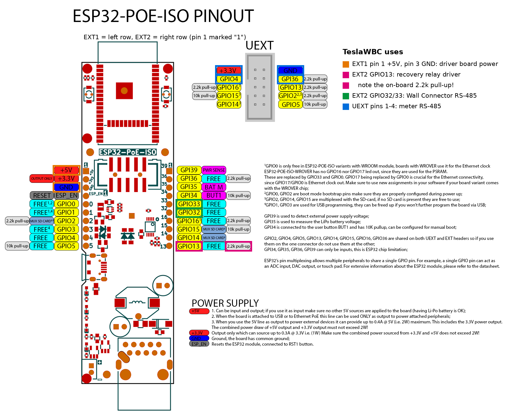

# Relay driver board (piggyback for the recovery relay)

GPIO13 of the ESP32 can source only about 20 mA at 3.3 V. The Finder 38.51 interface relay with a 5 V coil needs about 35 to 40 mA at 5 V. This small board sits between them: GPIO13 switches a transistor, and the transistor switches the relay coil from the board's 5 V.

Only needed for the optional automatic recovery (see README, *Automatic recovery*).

## Bill of materials

| Ref | Qty | Part | Value / type | Notes |
|---|---|---|---|---|
| Q1 | 1 | NPN transistor | BC337-40, TO-92 | 800 mA, hFE ≥ 250; BC337-25 or 2N2222A also work |
| R1 | 1 | Resistor | 1 kΩ, 0.25 W | Base resistor, about 2.6 mA from GPIO13 |
| R2 | 1 | Resistor | 330 Ω, 0.25 W | Pull-down on the GPIO13 input. Must be this low: the Olimex board has a 2.2 kΩ pull-up on GPIO13, which would switch the relay on while the ESP32 boots. With 330 Ω the input stays below 0.45 V when GPIO13 is not driven. When GPIO13 is high it draws about 10 mA through R2, well within the ESP32's limit |
| D1 | 1 | Diode | 1N4148 (or 1N4007) | Flyback diode across the coil. The Finder module has its own protection; D1 is a cheap second line |
| J1 | 1 | Screw terminal | 3-pole, 5.08 mm | To the ESP32: +5V, GND, GPIO13 |
| J2 | 1 | Screw terminal | 2-pole, 5.08 mm | To the Finder coil: A1 (+), A2 (−) |
| J3 | 1 | Pin header | 1 × 2, 2.54 mm, cut from a spare strip | Both pins on GND. Ground for the Wall Connector RS-485 module, since EXT2 has no GND pin |
| — | 1 | Perfboard | 72 × 50 mm, cut from a 50 × 100 mm board (Reichelt H25PR050) | 72 mm is the width the DIN-rail holder takes |
| — | 3 | Dupont jumper wires | female-female, 2.54 mm | +5V, GND, GPIO13 for the first setup. For the final installation, solder the wires onto the header pins |
| — | 1 | DIN-rail PCB holder | Delock 65989, 5 cm long | Holds the perfboard on the rail in Box 1 |
| — | 2 | Pin header | 1 × 10, 2.54 mm (Reichelt MPE 087-1-010) | Soldered into EXT1 and EXT2 of the Olimex board; spare pins for J3 |

The driver board sits in Box 1 (low voltage). The Finder 38.51.7.005.0050 (5 V DC coil), the ABB ESB25-04N-06 contactor and the ABB S201-C2 breaker (F2) for the coil circuit are in Box 2. See [wiring-diagram.png](wiring-diagram.png), [cabinet-layout.png](cabinet-layout.png) and [parts-list.md](parts-list.md).

## Circuit

```
 ESP32-POE-ISO                 driver board                       Finder 38.51 (5 V)
                         J1                       J2
 +5V (EXT1 pin 1) ──────── 1 ──────────┬────────── A1 (+) ─┐
                                       │                     coil
                                  D1 ─┴─ (cathode to +5V)    │
                                  1N4148                      │
                                       ├────────── A2 (−) ─┘
                                       │
                                       C
 GPIO13 ───────────────── 3 ──┬── R1 1k ── B   Q1 BC337
                               │             E
                            R2 330Ω          │
                               │             │
 GND ──────────────────── 2 ───┴─────────────┴──── GND
```

- GPIO13 high → Q1 conducts → coil on → Finder contact closes → 230 V on the ABB coil → Wall Connector **off**.
- GPIO13 low, floating (ESP32 booting) or ESP32 off → R2 holds the input below 0.45 V against the board's 2.2 kΩ pull-up, Q1 stays off → Finder open → ABB closed → Wall Connector **on**.

## Wiring to the Olimex board

| Driver J1 | Olimex ESP32-POE-ISO |
|---|---|
| 1: +5V | EXT1 pin 1 (+5V). Fed by PoE; Olimex allows up to 0.4 A at 5 V, at most 2 W together with the 3.3 V output. The relay needs about 40 mA |
| 2: GND | EXT1 pin 3 (GND) |
| 3: GPIO13 | EXT2 pin 10, marked 13 on the silkscreen. GPIO13 is also UEXT pin 6; use only one of the two |

The meter's RS-485 module uses UEXT pins 1 to 4 only, so GPIO13 is free.



Pinout from Olimex, marked with the pins TeslaWBC uses.

## Checks before connecting the Finder

1. Power the ESP32 over PoE. Measure J2: 0 V between A1 and A2.
2. Press *Recover Wall Connector* on the web page with the Wall Connector's breaker **off**. J2 shows about 5 V for 1 minute; the Finder LED lights.
3. *Cancel Recovery*: back to 0 V.
4. Only then connect the Finder and, by an electrician, the 230 V side to the ABB coil.
